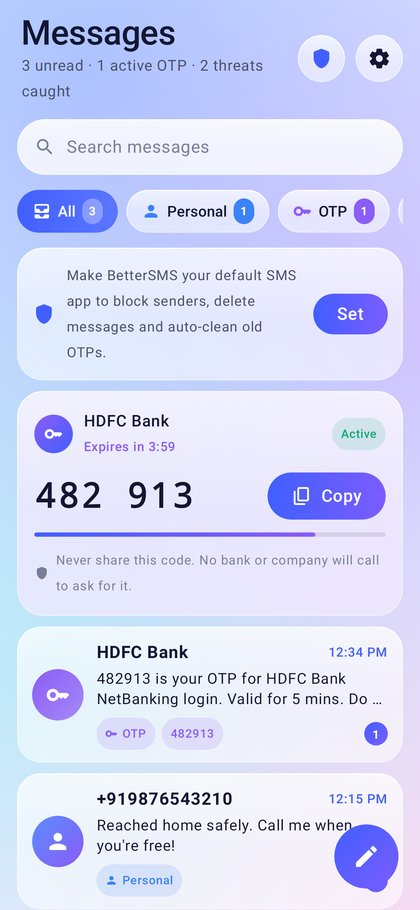
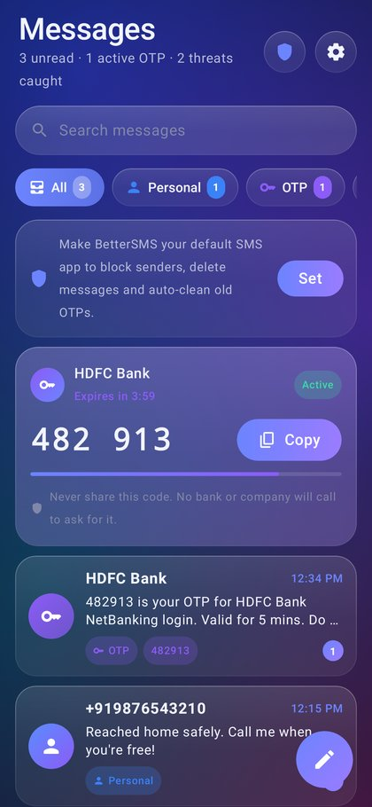
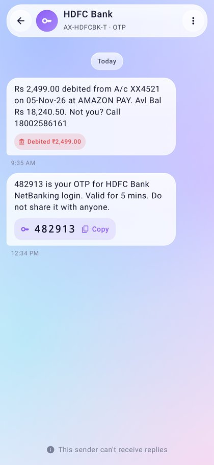
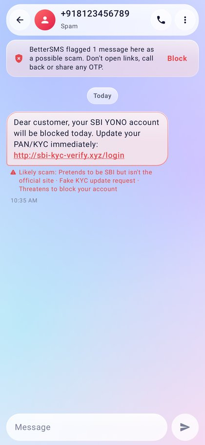
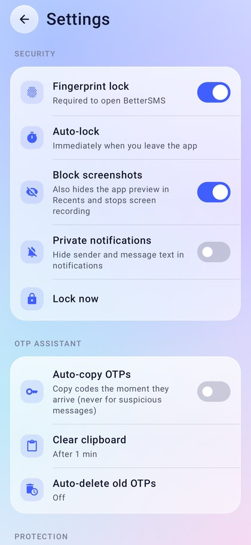
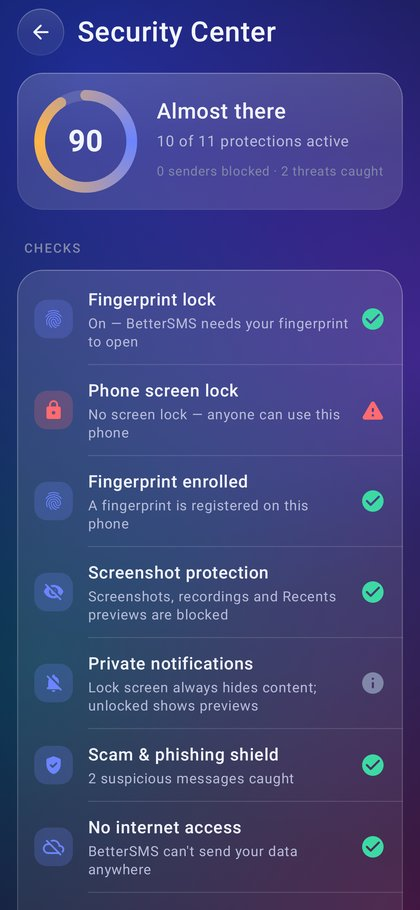
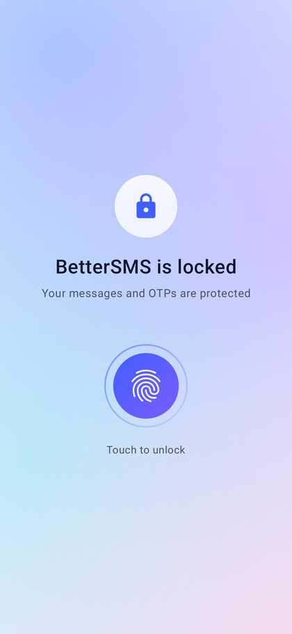
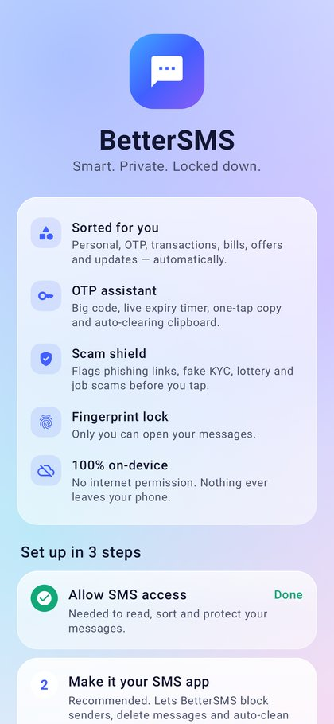

# BetterSMS

A smart, private SMS manager for Android with a frosted-glass look (inspired by vivo OriginOS).
Every message is sorted automatically, OTPs get their own assistant, scams are flagged before you
tap, and the whole app sits behind your fingerprint. It has **no internet permission**, so nothing
leaves your phone.

| Home | Dark glass | OTP | Scam warning |
|---|---|---|---|
|  |  |  |  |

| Settings | Security Center | Fingerprint lock | Onboarding |
|---|---|---|---|
|  |  |  |  |

## Install

1. Download `dist/BetterSMS-v1.0.0.apk` from this repo, or the `BetterSMS-apk` artifact of the latest
   **Build APK** GitHub Actions run.
2. Open it on your phone and allow "Install unknown apps" for your browser or file manager when asked.
3. Follow the 3 setup steps: allow SMS access, make BetterSMS your default SMS app (recommended), and
   turn on fingerprint lock.

Requires Android 8.0 (API 26) or newer.

## Features

### Smart categories
Messages are sorted on-device into **Personal, OTP, Transactions, Bills, Offers, Updates and Spam**.
The classifier combines keyword scoring with sender analysis, including India's TRAI DLT sender headers
(`AX-HDFCBK-S`, `BZ-MYNTRA-P`, and so on: the `-P/-S/-T/-G` suffix tells promotional, service,
transactional and government senders apart). A bank thread shows up under both OTP and Transactions,
each with its latest matching message. You can pin any sender to a category from the chat menu.
Transaction alerts show the amount as a debit or credit pill.

### OTP assistant
- Finds the code reliably and skips amounts, card or account digits, dates, reference numbers and
  phone numbers. Also handles `G-123456`, `<#>` and alphanumeric codes.
- Active OTPs are pinned to the top of the inbox with a big code, a live expiry countdown (read from
  "valid for 10 mins" in the message) and a one-tap **Copy**.
- The notification has a **Copy** button and dismisses itself when the code expires. On the lock
  screen the code is hidden and Copy requires unlocking the phone.
- Codes are copied as *sensitive*, so the Android 13+ clipboard preview and keyboards don't show
  them, and the clipboard is cleared after 30 s, 1 min or 2 min (you choose).
- Optional auto-copy on arrival, which never runs for suspicious messages.
- Optional auto-delete of old OTP messages after 1 h, 24 h or 7 days (needs default SMS app).

### Scam & phishing shield
- Flags fake KYC/PAN/Aadhaar updates, "account will be blocked" threats, lottery/KBC, job and
  easy-money scams, electricity disconnection, parcel/customs, remote-access app requests, `.apk` links,
  and anyone asking you to share an OTP, PIN or CVV.
- Checks every link for URL shorteners, raw IPs, punycode look-alikes, risky domain endings and brand
  impersonation (e.g. `sbi-kyc-verify.xyz` is not SBI). `.gov.in` and `.bank.in` domains are trusted.
- Links never open on a single tap: a dialog shows the real domain first and warns loudly if it looks
  dangerous.
- Dangerous messages go to Spam, show red warnings with reasons, and are never auto-copied.

### Security & privacy
| Protection | How |
|---|---|
| Fingerprint login | `BiometricPrompt` with your fingerprint, or your phone PIN as a fallback. On Android 11+ each unlock is bound to a Keystore key, and you're warned if fingerprints on the phone change. |
| Auto-lock | Locks right away or after 30 s, 1 min or 5 min in the background. The content is hidden from screen readers while locked. |
| Screenshot blocking | `FLAG_SECURE` blocks screenshots and screen recording and blanks the Recents preview. |
| Tapjacking defence | Touches are filtered while another app draws on top, and other apps' overlays are hidden on Android 12+. |
| Encrypted app data | Settings, block list and categories are stored with AES-256-GCM. The key is in the Android Keystore (hardware-backed on most phones) and the file is in no-backup storage. |
| No network | The `INTERNET` permission is removed in the manifest. Nothing is uploaded, and there is no analytics. |
| No backups | `allowBackup=false` plus data-extraction rules that exclude everything from cloud backup and device transfer. |
| Private notifications | The lock screen always shows a redacted version. Optionally hide sender and text everywhere. |
| Sender blocking | Messages from blocked senders are silent, marked read and kept out of the inbox. |
| Security Center | Shows a protection score covering app lock, screen lock, fingerprint, root, USB debugging, debugger, backups, encryption and network. |
| Erase data | Wipes BetterSMS data and destroys its encryption key after you confirm with your fingerprint. Your SMS are not touched. |

## Build

```bash
./gradlew testDebugUnitTest   # classifier tests + Robolectric screen tests (writes app/build/screenshots)
./gradlew assembleRelease     # app/build/outputs/apk/release/app-release.apk
```

Requires JDK 17+ and the Android SDK (platform 35).

**Signing.** To sign with your own key, set `BETTERSMS_KEYSTORE`, `BETTERSMS_KEYSTORE_PASSWORD`,
`BETTERSMS_KEY_ALIAS` and `BETTERSMS_KEY_PASSWORD`. Without them, the release APK is signed with the
build machine's debug key so it can still be sideloaded. Builds from different machines therefore have
different signatures: uninstall before installing a build from another machine.

## Permissions

| Permission | Why |
|---|---|
| `READ_SMS`, `RECEIVE_SMS`, `SEND_SMS`, `RECEIVE_MMS`, `RECEIVE_WAP_PUSH` | Read, sort, receive and send messages (the last two are required for the default-SMS-app role) |
| `READ_CONTACTS` | Show contact names instead of numbers |
| `POST_NOTIFICATIONS` | New-message and OTP alerts |
| `USE_BIOMETRIC` | Fingerprint lock |
| `HIDE_OVERLAY_WINDOWS` | Hide other apps' overlays while BetterSMS is open |

## Limitations

- **MMS (picture or group messages) are not downloaded yet.** If BetterSMS is your default SMS app,
  incoming MMS won't be shown. Keep another app as default if you rely on MMS.
- Blocking, deleting and OTP auto-delete need BetterSMS to be the default SMS app (an Android rule).
  Without that, sorting, OTP help, scam warnings and notifications still work.
- Sending uses the phone's default SIM for SMS.
- Categorisation and scam detection use on-device rules tuned for Indian and English-language SMS.
  They are not a guarantee, so stay careful with any message asking for money or codes.

## Project layout

```
app/src/main/java/com/bettersms/app/
  classify/   OtpExtractor, ThreatDetector, MessageClassifier, SenderAnalyzer (pure Kotlin, unit-tested)
  data/       SmsRepository (provider → classified inbox), SecureStore (encrypted settings), SmsProvider
  sms/        Receivers (SMS_DELIVER / SMS_RECEIVED / WAP_PUSH), SmsSender, HeadlessSmsSendService
  notify/     Notifier (channels, OTP Copy action, direct reply), NotificationActionReceiver
  security/   AppLockManager, BiometricAuth, ClipboardGuard, DeviceIntegrity
  ui/         Glass theme + components, Home, Conversation, New message, Lock, Onboarding, Settings, Security Center
```
